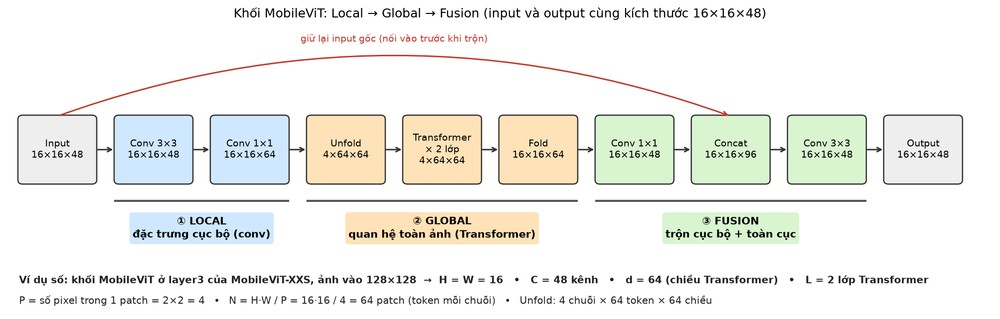
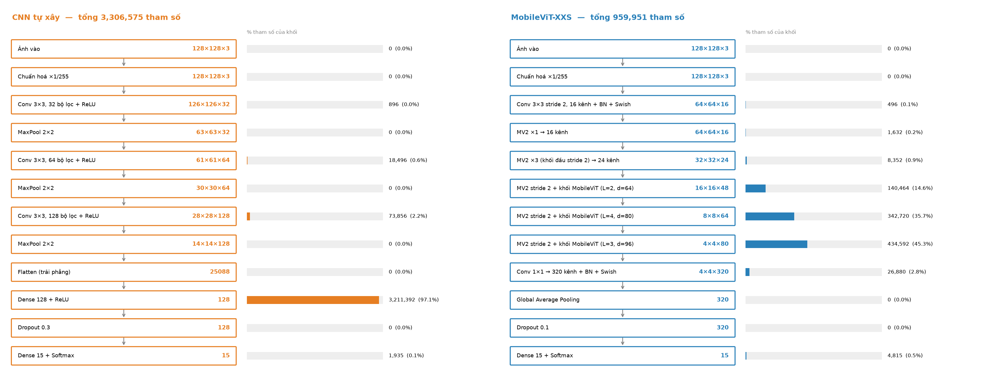
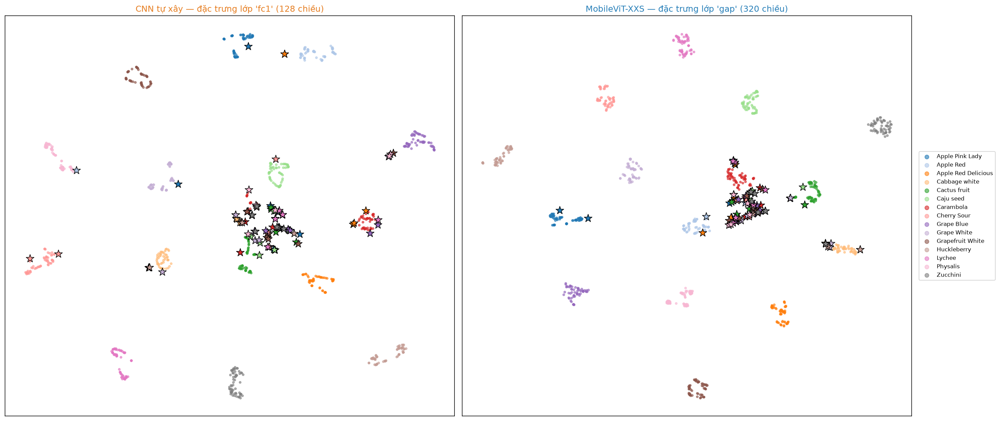
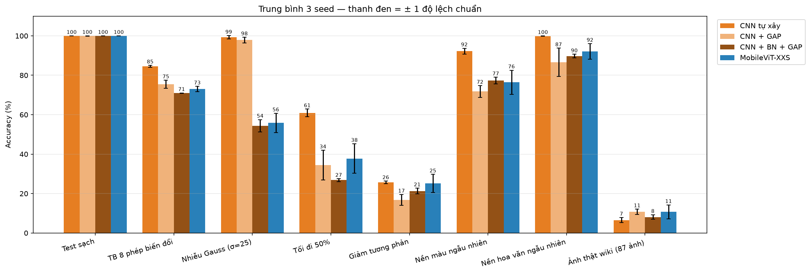

# 🍎 Fruit Classification: MobileViT vs. Self-built CNN

> So sánh **MobileViT-XXS** (CNN + Transformer, tự cài đặt lại bằng Keras, train từ đầu) với một **CNN tự xây dựng** trên bài toán phân loại 15 loại trái cây (Fruits-360). Không chỉ so accuracy mà còn kiểm tra: tập Test có đáng tin không, kích thước và tốc độ, độ bền khi ảnh bị biến đổi, ảnh thật ngoài dataset, và yếu tố nào (đầu phân loại, BatchNorm, Transformer) tạo ra sự khác biệt.
>
> *A from-scratch Keras implementation of MobileViT-XXS compared with a self-built CNN on 15 Fruits-360 classes: accuracy, leakage check, model size, FLOPs, latency, robustness, real-world photos, and a factor-isolation experiment (4 models × 3 seeds).*

**Đồ án môn học** — Trần Duy Đang (MSSV 106220126), Nhóm 17, Khoa Điện tử – Viễn thông, Trường Đại học Bách khoa – Đại học Đà Nẵng.

---

## Điểm nổi bật

- **MobileViT cài đặt từ đầu**, không dùng mô hình có sẵn và **không pretrained**: khối MV2 (inverted residual), Unfold/Fold, Transformer encoder, khối MobileViT. Dựng lại cấu hình gốc của paper (ảnh 256×256, 1.000 lớp) cho số tham số **1,28M / 2,33M / 5,59M** so với **1,3M / 2,3M / 5,6M** của paper (XXS / XS / S). Đây là điều kiện cần chứ chưa đủ để chứng minh cài đúng hoàn toàn.
- **So sánh công bằng**: cùng dữ liệu, ảnh 128×128, cùng augmentation, cùng optimizer (AdamW, warm-up + cosine decay), tối đa 30 epoch, EarlyStopping; cả hai train từ đầu.
- **Không dừng ở 100%**: kiểm tra rò rỉ dữ liệu, thử 87 ảnh thật, đo domain shift bằng t-SNE, rồi train thêm 2 mô hình CNN trung gian × 3 seed để tách yếu tố.
- Đánh giá nhiều chiều: accuracy & macro-F1, McNemar, khoảng tin cậy Wilson, số tham số, FLOPs, độ trễ, thí nghiệm ít dữ liệu, 8 kiểu biến đổi ảnh, Grad-CAM.

## Kết quả chính

| Tiêu chí | CNN tự xây | MobileViT-XXS |
|---|---|---|
| Accuracy trên Test sạch (3.592 ảnh) | 100% (0 ảnh sai) | 100% (0 ảnh sai) |
| Số tham số | 3,31 triệu | **0,96 triệu** (ít hơn 3,4×) |
| Dung lượng (float32) | 13,2 MB | **3,8 MB** |
| Số phép tính / ảnh | 0,287 GFLOPs | **0,174 GFLOPs** |
| Độ trễ GPU (RTX 3060, 1 ảnh) | **1,4 ms** | 12,5 ms |
| Thời gian train / epoch | **4,2 s** | 8,2 s |
| Accuracy khi chỉ có 2% dữ liệu train | 96,2% | 95,9% |
| TB 8 phép biến đổi ảnh (3 seed) | **84,5 ± 0,5%** | 73,0 ± 1,3% |
| Nhiễu Gauss σ=25 (3 seed) | **99,2 ± 0,9%** | 55,8 ± 4,9% |
| Nền màu ngẫu nhiên (3 seed) | **92,2 ± 1,5%** | 76,4 ± 6,1% |
| 87 ảnh thật, đủ 15 lớp (1 lần chạy) | 5/87 = 5,7% (CI 95%: 2,5–12,8%) | 12/87 = 13,8% (CI 95%: 8,1–22,6%) |
| 87 ảnh thật (trung bình 3 seed) | 6,5 ± 1,3% | 10,7 ± 3,5% |

Đoán ngẫu nhiên trên 15 lớp cho khoảng 6,7%. Số đo độ trễ trên CPU trong notebook có vẻ bất thường (không đưa vào bảng trên và không dùng để kết luận).

### Bốn mô hình × 3 seed (mục 12 của notebook)

| Mô hình | Đầu phân loại | BatchNorm | Transformer | Tham số | Nhiễu Gauss | Nền màu | Ảnh thật |
|---|---|---|---|---|---|---|---|
| CNN tự xây | Flatten + Dense 128 | không | không | 3.306.575 | 99,2 ± 0,9 | 92,2 ± 1,5 | 6,5 ± 1,3 |
| CNN + GAP | GAP + Dense 128 | không | không | 111.695 | 97,8 ± 1,4 | 71,8 ± 3,0 | 10,7 ± 1,3 |
| CNN + BN + GAP | GAP + Dense 128 | có | không | 112.367 | 54,3 ± 3,2 | 77,3 ± 1,7 | 8,0 ± 1,1 |
| MobileViT-XXS | GAP | có | có | 959.951 | 55,8 ± 4,9 | 76,4 ± 6,1 | 10,7 ± 3,5 |

(Accuracy %, trung bình ± độ lệch chuẩn qua seed 42, 43, 44.)

### Nhận xét

1. **100% trên Test chưa nói được gì nhiều.** Chỉ cần tra ảnh Train giống nhất theo pixel (không học gì) đã đoán đúng 100% lớp của ảnh Test. Test xa Train hơn Val khoảng 1,8 lần (khoảng cách pixel trung vị 0,037 so với 0,020), nên không bị rò rỉ nặng như Val, nhưng bài toán vẫn rất dễ. Tập Val thì bị rò rỉ vì Fruits-360 được cắt từ video quả xoay, nên mọi kết luận dựa trên Test và các thí nghiệm ngoài.
2. **MobileViT ít tham số hơn chủ yếu do đầu phân loại, không phải do Transformer.** `fc1` của CNN chiếm 97% tham số; khi thay Flatten bằng Global Average Pooling, CNN chỉ còn 111.695 tham số (nhỏ hơn MobileViT khoảng 8,6 lần). Phần thân của MobileViT lớn khoảng 10 lần phần Conv của CNN.
3. **Ít tham số, ít FLOPs không có nghĩa là nhanh hơn.** Trên GPU, MobileViT chậm hơn CNN khoảng 9 lần với một ảnh. Có thể do nhiều lớp nhỏ nối tiếp và các phép reshape/attention, nhưng notebook chưa profile từng lớp nên đây chỉ là giả thuyết.
4. **CNN bền hơn MobileViT** trên nhiễu, ảnh tối và đổi nền. Khi tách yếu tố, điểm yếu với nhiễu xuất hiện ngay khi thêm BatchNorm vào CNN (CNN + BN + GAP 54,3% so với CNN + GAP 97,8%) và MobileViT gần như y hệt CNN + BN + GAP, nên **chưa có bằng chứng** rằng Transformer là nguyên nhân. Với nền màu và nền hoa văn, mức tụt xảy ra khi đổi Flatten + Dense thành GAP.
5. **Cả hai đều kém trên ảnh thật** (5,7% và 13,8% trên 87 ảnh). Hai khoảng tin cậy chồng nhau và McNemar (2 so với 9 ảnh bất đồng) cho p ≈ 0,065, nên **chưa đủ bằng chứng để chọn mô hình nào tốt hơn**. Ảnh thật nằm cách ảnh Test xa gấp 23,2 lần (CNN) và 17,5 lần (MobileViT) trong không gian đặc trưng: dấu hiệu của *domain shift*. Cắt sát quả không thay đổi kết quả.

### Giới hạn cần biết

- Chỉ có **87 ảnh thật** và **3 seed**: khoảng tin cậy rộng, độ lệch chuẩn chỉ là ước lượng thô; các kết luận ở mục 4–5 trên là gợi ý, không phải khẳng định.
- Hai mô hình khác nhau ở nhiều chỗ cùng lúc (BatchNorm, GAP, Swish, MV2, Transformer); thí nghiệm tách yếu tố chưa tách hết từng thứ.
- Ảnh 128×128: ở khối cuối (layer5) MobileViT chỉ còn 4×4 = **4 token** mỗi chuỗi (paper dùng 256×256). Chưa thử 256×256.
- Augmentation chỉ gồm lật, xoay, zoom; không có đổi sáng, nhiễu hay đổi nền.
- Một số số liệu ở mục 6–8 của notebook được nạp lại từ `results.json` của lần chạy trước, nên có thể lệch nhẹ so với bảng 3 seed ở mục 12.6; khi lệch, ưu tiên mục 12.6.

## Hình minh hoạ

| | |
|---|---|
|  |  |
|  |  |

Toàn bộ hình và số liệu nằm trong thư mục [`results/`](results/) (`results.json`, `results_updated.json`, `seeds_table.csv`, các hình `01_` … `12f_`).

## Cấu trúc thư mục

```
├── MobileViT_vs_CNN_updated.ipynb  # Notebook chính (bản cập nhật): lý thuyết, cài đặt MobileViT, huấn luyện, so sánh, kiểm tra bổ sung (mục 12)
├── Fruit_CNN_Classification.ipynb  # Notebook ban đầu: tạo bộ dữ liệu con 15 lớp (fruits_subset/) — cần chạy trước
├── external_test_wiki/             # 87 ảnh thật (Wikimedia Commons, đủ 15 lớp) + CREDITS.csv ghi tác giả và giấy phép
├── results/                        # Hình vẽ + số liệu kết quả
├── requirements.txt
└── README.md
```

Thư mục `fruits_subset/` (dữ liệu) và `model/` (mô hình đã train) được tạo khi chạy notebook, không nằm trong repo.

## Dữ liệu

- [Fruits-360](https://www.kaggle.com/datasets/moltean/fruits) (bản 100×100), 15 loại: Apple Pink Lady, Apple Red, Apple Red Delicious, Cabbage white, Cactus fruit, Caju seed, Carambola, Cherry Sour, Grape Blue, Grape White, Grapefruit White, Huckleberry, Lychee, Physalis, Zucchini. Train 8.583 / Val 2.146 (tách 20% phân tầng từ thư mục Training) / Test 3.592 ảnh. Ảnh được resize về 128×128.
- **Ảnh thật** (`external_test_wiki/`): 87 ảnh, 5–6 ảnh mỗi lớp, lấy từ Wikimedia Commons (không lấy từ Kaggle hay Fruits-360), nhãn kiểm tra bằng mắt. Tác giả và giấy phép từng ảnh ghi trong `external_test_wiki/CREDITS.csv`; khi dùng lại cần giữ phần ghi công này.

## Cách chạy

```bash
python -m venv venv && source venv/bin/activate
pip install -r requirements.txt
```

1. Chạy `Fruit_CNN_Classification.ipynb` tới bước tạo thư mục `fruits_subset/` (tự tải dataset qua `kagglehub`).
2. Đảm bảo thư mục `external_test_wiki/` nằm cạnh notebook.
3. Chạy `MobileViT_vs_CNN_updated.ipynb` từ trên xuống. Các mục 0–11 mất khoảng 1 giờ trên RTX 3060 (phần lớn là thí nghiệm ít dữ liệu, có thể tắt bằng `RUN_DATA_EFFICIENCY = False`). **Mục 12.5** train thêm 10 mô hình (3 seed × 4 mô hình, dùng lại seed 42 của 2 mô hình chính), khoảng 30–35 phút; đặt `RUN_SEED_TRAINING = False` để bỏ qua.
4. Đã train rồi thì dùng ô **4b. Khôi phục** để nạp lại mô hình đã lưu, không cần train lại (đừng bấm Run All).

Môi trường đã dùng: Python 3.14, TensorFlow 2.22 / Keras 3, GPU NVIDIA RTX 3060, WSL2 Ubuntu.

## Tài liệu tham khảo

- S. Mehta, M. Rastegari. *MobileViT: Light-weight, General-purpose, and Mobile-friendly Vision Transformer.* ICLR 2022. [arXiv:2110.02178](https://arxiv.org/abs/2110.02178)
- M. Sandler et al. *MobileNetV2: Inverted Residuals and Linear Bottlenecks.* CVPR 2018.
- A. Dosovitskiy et al. *An Image is Worth 16x16 Words: Transformers for Image Recognition at Scale.* ICLR 2021.
- H. Mureșan, M. Oltean. *Fruit recognition from images using deep learning.* Acta Univ. Sapientiae, Informatica, 2018 (bộ dữ liệu Fruits-360).
