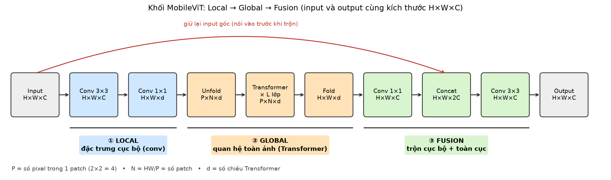
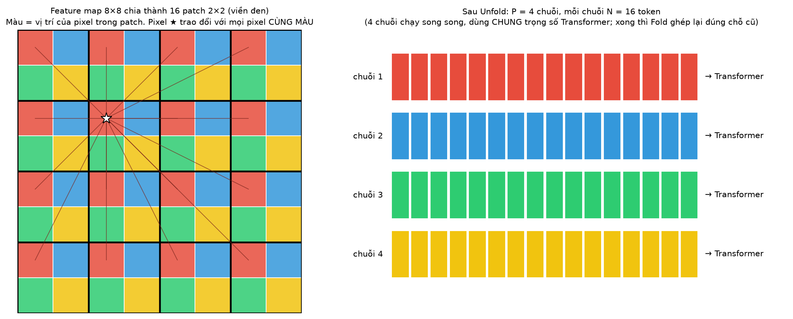
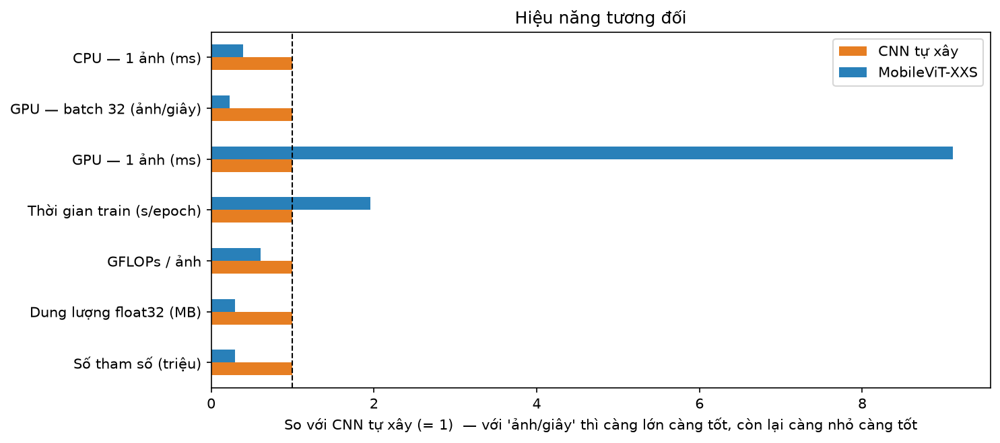
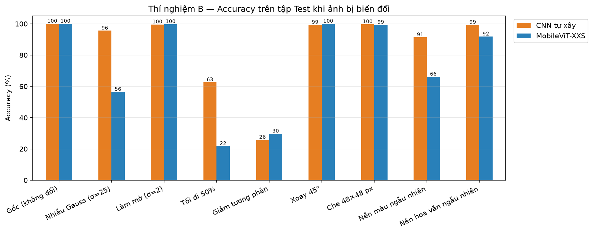

# 🍎 Fruit Classification: MobileViT vs. Self-built CNN

> So sánh **MobileViT** (CNN + Transformer, cài đặt lại từ đầu bằng Keras) với một **CNN tự xây dựng** trên bài toán phân loại 15 loại trái cây (Fruits-360) — không chỉ so độ chính xác mà còn so kích thước, tốc độ, độ bền với nhiễu, khả năng học khi ít dữ liệu và khả năng tổng quát hoá ra ảnh thật.
>
> *Comparing a from-scratch Keras implementation of MobileViT with a simple CNN on Fruits-360 — accuracy, model size, FLOPs, latency, robustness, data efficiency and real-world generalization.*

**Đồ án môn học** — Trần Duy Đang, Khoa Điện tử – Viễn thông, Trường Đại học Bách khoa – Đại học Đà Nẵng.

---

## Điểm nổi bật

- **MobileViT cài đặt từ đầu** (không dùng mô hình có sẵn): khối MV2 (inverted residual), Unfold/Fold, Transformer encoder, khối MobileViT. Kiểm chứng bằng cách dựng lại đúng cấu hình của paper — số tham số khớp: **1,28M / 2,33M / 5,59M** so với **1,3M / 2,3M / 5,6M** (XXS / XS / S).
- **So sánh công bằng**: cùng dữ liệu, cùng augmentation, cùng optimizer (AdamW, warm-up + cosine decay), cùng số epoch, cả 2 mô hình đều train từ đầu.
- **Đánh giá nhiều chiều**: accuracy & macro-F1, kiểm định McNemar, số tham số, FLOPs, độ trễ GPU, thí nghiệm ít dữ liệu, 8 kiểu biến đổi ảnh (nhiễu, mờ, tối, xoay, che, đổi nền…), ảnh thật thu thập từ internet, Grad-CAM.

## Kết quả chính

| Tiêu chí | CNN tự xây | MobileViT-XXS |
|---|---|---|
| Accuracy trên tập Test (3.592 ảnh) | 100% | 100% |
| Số tham số | 3,31 triệu | **0,96 triệu** (ít hơn 3,4×) |
| Dung lượng (float32) | 13,2 MB | **3,8 MB** |
| Số phép tính / ảnh | 0,287 GFLOPs | **0,174 GFLOPs** |
| Độ trễ GPU (RTX 3060, 1 ảnh) | **1,4 ms** | 12,5 ms |
| Thời gian train / epoch | **4,2 s** | 8,2 s |
| Accuracy TB khi ảnh bị biến đổi | **84,1%** | 70,6% |
| Accuracy TB khi đổi nền | **95,3%** | 79,0% |
| Accuracy khi chỉ có 2% dữ liệu train | 96,2% | 95,9% |
| Accuracy trên 24 ảnh thật (internet) | 25% | 25% |

**Nhận xét:**
1. Trên tập Test của Fruits-360, cả 2 mô hình đều đạt 100% — bộ dữ liệu (nền trắng, điều kiện chụp chuẩn hoá) quá dễ để phân biệt 2 kiến trúc chỉ bằng accuracy.
2. **MobileViT nhẹ hơn** nhiều (Global Average Pooling thay cho Flatten + Dense; depthwise convolution), nhưng **chạy chậm hơn trên GPU**: ít FLOPs không đồng nghĩa với nhanh hơn, vì MobileViT có nhiều lớp nhỏ nối tiếp và các phép reshape/attention.
3. **CNN bền hơn** khi ảnh bị nhiễu, tối đi hoặc đổi nền; MobileViT (train từ đầu, không pretrain) nhạy hơn với thay đổi độ sáng toàn ảnh.
4. **Cả 2 đều tổng quát hoá kém ra ảnh thật** (~25%, gần như chỉ nhận đúng bí ngòi — loại duy nhất có hình dạng khác biệt). Cắt sát quả cho giống khung hình của dataset không cải thiện ⇒ nguyên nhân là *domain shift*: mô hình học màu sắc/kết cấu theo điều kiện chụp riêng của Fruits-360.

> Ghi chú: tập ảnh thật chỉ có 24 ảnh nên con số mang tính minh hoạ (khoảng tin cậy 95% xấp xỉ 12–45%).

## Hình minh hoạ

| | |
|---|---|
|  |  |
|  |  |

Toàn bộ hình và số liệu nằm trong thư mục [`results/`](results/) (`results.json`, `summary_table.csv`).

## Cấu trúc thư mục

```
├── MobileViT_vs_CNN.ipynb          # Notebook chính: lý thuyết, cài đặt MobileViT, huấn luyện, so sánh, thí nghiệm
├── Fruit_CNN_Classification.ipynb  # Notebook ban đầu: tạo bộ dữ liệu 15 lớp, CNN tự xây, transfer learning MobileNetV2
├── results/                        # Hình vẽ + số liệu kết quả
├── requirements.txt
└── README.md
```

## Dữ liệu

[Fruits-360](https://www.kaggle.com/datasets/moltean/fruits) (bản 100×100), chọn ngẫu nhiên 15 loại (seed 42), gộp các biến thể cùng loại: Apple Pink Lady, Apple Red, Apple Red Delicious, Cabbage white, Cactus fruit, Caju seed, Carambola, Cherry Sour, Grape Blue, Grape White, Grapefruit White, Huckleberry, Lychee, Physalis, Zucchini. Train 8.583 / Val 2.146 / Test 3.592 ảnh. Ảnh được resize về 128×128.

## Cách chạy

```bash
python -m venv venv && source venv/bin/activate
pip install -r requirements.txt
```

1. Chạy `Fruit_CNN_Classification.ipynb` tới bước tạo thư mục `fruits_subset/` (tự tải dataset qua `kagglehub`).
2. Chạy `MobileViT_vs_CNN.ipynb` từ trên xuống. Toàn bộ mất khoảng 1 giờ trên RTX 3060 (phần lớn là thí nghiệm ít dữ liệu — có thể tắt bằng `RUN_DATA_EFFICIENCY = False`).
3. Đã train rồi thì dùng ô **4b. Khôi phục** để nạp lại mô hình đã lưu, không cần train lại.

Môi trường đã dùng: Python 3.14, TensorFlow 2.22 / Keras 3, GPU NVIDIA RTX 3060, WSL2 Ubuntu.

## Tài liệu tham khảo

- S. Mehta, M. Rastegari. *MobileViT: Light-weight, General-purpose, and Mobile-friendly Vision Transformer.* ICLR 2022.
- M. Sandler et al. *MobileNetV2: Inverted Residuals and Linear Bottlenecks.* CVPR 2018.
- A. Dosovitskiy et al. *An Image is Worth 16x16 Words: Transformers for Image Recognition at Scale.* ICLR 2021.
- H. Mureșan, M. Oltean. *Fruit recognition from images using deep learning.* Acta Univ. Sapientiae, Informatica, 2018 (bộ dữ liệu Fruits-360).
